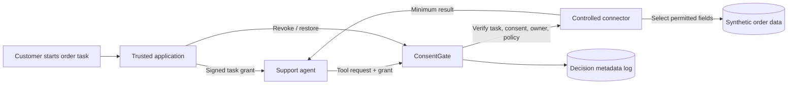

# ConsentGate

**Purpose-bound data access for AI customer-support agents.** ConsentGate is a working, synthetic-data prototype for the BUILD 2036 Digital Infrastructure track. It demonstrates how a support agent can answer an order-status question while receiving only the two fields needed for that task.

> **Demo, not production security software.** All identities and records are synthetic. The public dashboard has no login and exposes reset and consent controls so judges can replay scenarios. Do not connect this deployment to real customer data or a real CRM.

## What the app includes

- **Operator console:** overview, live simulator, consent center, decision log, and fixed evaluation suite.
- **Trusted task grants:** a short-lived HMAC-signed token binds tenant, customer, order, purpose, policy version, and consent version. The agent cannot change these claims without invalidating the signature.
- **Policy decision point:** checks token integrity, expiry, current consent version, operation, and resource ownership. It fails closed on invalid grants.
- **Controlled connector:** selects only `status` and `delivery_window` for `ORDER_STATUS` before returning data to the protected agent.
- **Privacy counterfactual:** runs a deliberately broad tool-level baseline beside the protected path, showing which synthetic fields reach each agent.
- **Mid-run revocation:** first read succeeds, the customer withdraws consent, and a second read using the same task token is denied.
- **Decision log:** metadata-only hash chain with verification. It records field names, never field values.
- **Optional Groq agent:** a real model performs a tool-call round trip and writes the customer response. The app works without a Groq key using a deterministic offline agent.
- **Reproducible checks:** seven fixed synthetic authorization scenarios, plus unit and API tests.

## Quick start

Requires Python 3.12.

```bash
python -m venv .venv
# Windows PowerShell:
.venv\Scripts\Activate.ps1
# macOS / Linux: source .venv/bin/activate
pip install -r requirements.txt
python -m uvicorn consentgate.app:app --reload
```

Open `http://127.0.0.1:8000`. API docs are at `http://127.0.0.1:8000/docs`. The default run needs no external service.

To enable the optional Groq agent, set `GROQ_API_KEY` in the process environment and restart. Do not commit the key. The Groq checkbox sends synthetic tool-result data to Groq; it is off by default. `GROQ_MODEL` defaults to `llama-3.3-70b-versatile` and can be changed to a currently supported tool-calling model. Check [Groq's current tool-use documentation](https://console.groq.com/docs/tool-use/overview) before changing models.

```powershell
$env:GROQ_API_KEY = "your-key"
python -m uvicorn consentgate.app:app --reload
```

## Three-minute demo

1. **0:00–0:20** — Open **Live simulator** and show Order 101. Explain that the trusted app issues a task for one customer and one order.
2. **0:20–1:15** — Click **Run comparison**. Both lanes answer the question. The broad baseline exposes its full synthetic record; ConsentGate exposes only `status` and `delivery_window`. Show the hostile text in `internal_note` in the baseline. The protected connector does not return that note.
3. **1:15–2:15** — Click **Start and pause**, **Withdraw consent**, then **Resume same task**. The first read succeeds; the second is denied because the consent version has changed.
4. **2:15–2:45** — Open **Decision log** and show the allow and deny rules plus hash-chain verification.
5. **2:45–3:00** — State the limit: this protects future reads through the controlled connector. It does not erase copies already outside the system or certify legal compliance.

For a live model-driven answer, enable Groq and tick **Use Groq agent** before running the comparison. If the API is unavailable, untick it and use the deterministic demo. The deterministic path is the reliable judging fallback.

## Architecture



**Trust boundary:** prompts, retrieved notes, model output, and tool arguments are untrusted. The application signs the task grant. The gateway verifies it on every protected read. An agent-supplied purpose string does not authorize access. The demo's synthetic customer controls are public and are not a substitute for real authentication.

### API map

| Endpoint | Use |
|---|---|
| `GET /health` | Render health check |
| `GET /api/state` | Synthetic orders, consent state, recent decisions, Groq availability |
| `POST /api/tasks` | Issue an `ORDER_STATUS` grant for a synthetic order |
| `POST /api/access` | Protected tool call and field-selected response |
| `POST /api/demo/counterfactual` | Deterministic side-by-side comparison |
| `POST /api/agent` | Offline or Groq-backed answer for one lane |
| `POST /api/consent/revoke` | Withdraw synthetic consent |
| `POST /api/consent/restore` | Restore it with a new version |
| `GET /api/audit` | Decision records and chain verification |
| `GET /api/evaluate` | Fixed synthetic security scenarios |
| `POST /api/reset` | Reset all in-memory demo state |

The OpenAPI page at `/docs` provides request and response examples. Try `POST /api/tasks` with `{"order_id":"order-101"}`, then use its token with `POST /api/access` and `{"operation":"get_order_status","target":"order-101"}`.

## Policy and data model

`ORDER_STATUS` currently permits exactly one operation, `get_order_status`, on the grant's order. The connector returns only `status` and `delivery_window`. The record must match the grant's tenant and customer. A grant expires after ten minutes by default. The current consent version must match the version bound into the grant, so a revoked grant cannot be reused after restoration.

The baseline intentionally returns all non-key fields for a selected synthetic order, including contact details and an injected note. It is **our comparison configuration**, not a claim that Permit or any other gateway necessarily returns broad data. The protected path never reads or forwards the hidden note to its agent.

The audit log stores operation, target, field names, decision, rule, task ID, and previous-record hash. A modified old record fails verification. A party that can replace the entire log and its anchor can still rewrite history; this prototype has no external anchor or independent witness. The log is in memory and resets on restart.

## Run tests

```bash
python -m unittest discover -s tests -v
```

The evaluation API returns a separate, fixed synthetic scenario run. It checks legitimate access, full-profile denial, cross-customer and cross-tenant requests, token tampering, expiry, and mid-run revocation. These tests show behavior under their stated inputs, not production attack resistance or real-world incident reduction.

## Render deployment

The repository includes [`render.yaml`](render.yaml), which defines a Python web service, `/health` check, generated task-signing secret, and secret prompt for `GROQ_API_KEY`. [Render documents Blueprint configuration](https://render.com/docs/blueprint-spec) and [FastAPI deployment](https://render.com/docs/deploy-fastapi).

1. Push this repository to GitHub.
2. In Render, choose **New → Blueprint**, connect this repository, and select `render.yaml`.
3. Enter `GROQ_API_KEY` only in Render's secret prompt. If you do not want live model calls, create a regular Web Service instead and omit this variable; offline mode will still work. Render's Blueprint may prompt for a `sync: false` value on initial creation.
4. Confirm the build command is `pip install -r requirements.txt` and the start command is `uvicorn consentgate.app:app --host 0.0.0.0 --port $PORT`.
5. Wait for the health check, open the service URL, and run the two demo moments.

The free Render service may sleep and its memory state disappears on restart. Use one worker for the demo. A production pilot would need persistent consent state and audit storage, authentication, tenant isolation, key rotation, rate limits, and operational review.

## Security and privacy limits

- This public demo is intentionally unauthenticated. Anyone with its URL can reset synthetic state, withdraw synthetic consent, and run the optional Groq agent against synthetic records. Set a Groq budget or leave the key unset on a public demo.
- The HMAC task grant shows trust binding, but the issuer endpoint is itself public in the synthetic demo. Real issuance must happen only after actual user authentication and authorization.
- There is no real Consent Manager integration, CRM connection, OAuth flow, persistent database, multi-instance consistency, or cache deletion guarantee.
- The Groq path uses only synthetic data. Before processing actual personal data with any external model, review contracts, residency, retention, and organizational approval. See [Groq's data documentation](https://console.groq.com/docs/your-data).
- The system models a consent-based demo workflow. India's [DPDP Act](https://www.meity.gov.in/static/uploads/2024/02/Digital-Personal-Data-Protection-Act-2023-1.pdf) also recognizes certain legitimate uses. This prototype does not determine the lawful basis for a real organization. See the official [DPDP Rules](https://www.meity.gov.in/static/uploads/2025/11/53450e6e5dc0bfa85ebd78686cadad39.pdf?v=20261027115856).

## Prior art and claim

[Permit MCP Gateway](https://docs.permit.io/permit-mcp-gateway/) already provides agent consent, authorization, and audit; an [open-source consent gateway](https://github.com/realitymatrix/consent-gateway) describes a proxy with hash-chained receipts. [MCP authorization guidance](https://github.com/modelcontextprotocol/modelcontextprotocol/blob/main/docs/docs/2026-07-28/tutorials/security/authorization.mdx) covers OAuth-based server access. ConsentGate does not claim to invent gateways, consent, task-scoped access, or audit logs.

**Defensible prototype claim:** “ConsentGate demonstrates task-bound, customer-bound, field-level data minimization for an AI support agent, with a reproducible broad tool-permission baseline and a mid-run consent-change test.” Whether this is meaningfully different from existing commercial configurations remains to be validated.

## Pilot path

For a real pilot, select one enterprise support workflow and obtain a controlled API connector and review from its security, privacy, and legal teams. Replace public demo controls with authenticated customer and operator flows; persist consent versions and decision records; test against a real tool-level gateway configuration; measure unauthorized-field exposure, benign task completion, false denial, and latency. Do not expand to other purposes until the first workflow works reliably.

