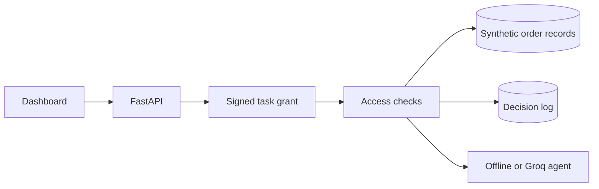

# ConsentGate

ConsentGate is a web app that limits what customer data an AI support agent can read for a specific task. The included workflow answers “Where is my order?” using only the order status and delivery window.

The repository contains a FastAPI backend, a browser dashboard, synthetic order records, an optional Groq-powered agent, and automated tests.

## Features

- **Task grants:** A signed, short-lived token identifies the tenant, customer, order, purpose, and consent version.
- **Access checks:** The backend verifies the grant, current consent, requested operation, and order ownership on every protected read.
- **Field selection:** The protected order tool returns only `status` and `delivery_window`.
- **Side-by-side simulator:** Compare the protected result with a deliberately broad tool-access baseline and inspect the fields each path receives.
- **Mid-run withdrawal:** Allow a first read, withdraw consent, and see the next read with the same task token denied.
- **Decision log:** Inspect allow and deny decisions and verify the in-memory hash chain.
- **Evaluation page:** Run seven fixed access-control scenarios.
- **Optional Groq mode:** Use a Groq model to call a tool and draft the support response. Offline mode works without an API key.

## Run locally

Requires Python 3.12.

```powershell
python -m venv .venv
.\.venv\Scripts\Activate.ps1
pip install -r requirements.txt
uvicorn consentgate.app:app --reload
```

On macOS or Linux, activate the environment with `source .venv/bin/activate`. Open [http://127.0.0.1:8000](http://127.0.0.1:8000). The API reference is at `/docs`.

To enable Groq, set `GROQ_API_KEY` before starting the server. `GROQ_MODEL` defaults to `llama-3.3-70b-versatile`.

```powershell
$env:GROQ_API_KEY = "your-api-key"
uvicorn consentgate.app:app --reload
```

The **Use Groq agent** switch in the simulator is off by default. The key is used server-side and should never be committed. The Groq mode sends only the selected lane’s synthetic tool result to the model.

## Use the app

1. Open **Live simulator**, select an order, and click **Run comparison**. Both lanes answer the order question. The baseline receives the broader synthetic record; ConsentGate receives two fields.
2. Click **Start and pause** to issue a task and make its first permitted read.
3. Click **Withdraw consent**, then **Resume same task**. The second read is denied.
4. Open **Decision log** to inspect the rules applied to those requests.
5. Open **Evaluation** and run the fixed scenarios.

The baseline is a comparison configuration in this project. It does not represent a particular third-party product.

## Architecture



`consentgate/core.py` contains the task-token, policy, synthetic data, and audit logic. `consentgate/app.py` exposes the API and serves the dashboard from `consentgate/static/`. The protected order read selects permitted fields before returning a tool result to the agent.

Task tokens expire after ten minutes by default. Withdrawing consent changes the current consent state, so an existing task token cannot authorize another read. Restoring consent requires a new task token.

## API

| Endpoint | Description |
|---|---|
| `GET /health` | Health check |
| `GET /api/state` | Current synthetic orders, consent state, and recent decisions |
| `POST /api/tasks` | Issue an order-status task token |
| `POST /api/access` | Request a protected tool read |
| `POST /api/agent` | Run the offline or Groq agent for one comparison lane |
| `POST /api/demo/counterfactual` | Return a deterministic comparison |
| `POST /api/consent/revoke` | Withdraw synthetic consent |
| `POST /api/consent/restore` | Restore synthetic consent |
| `GET /api/audit` | Read decisions and verify the hash chain |
| `GET /api/evaluate` | Run fixed access-control scenarios |
| `POST /api/reset` | Reset the in-memory demo |

Example protected read: call `POST /api/tasks` with `{"order_id":"order-101"}`. Pass the returned token to `POST /api/access` with `{"token":"...","operation":"get_order_status","target":"order-101"}`.

## Tests

```powershell
python -m unittest discover -s tests -v
```

The tests cover permitted access, profile and cross-customer denial, expired and modified tokens, revocation, audit tampering, and API behavior. The in-app evaluation checks seven fixed synthetic scenarios.

## Deploy to Render

[](https://render.com/deploy?repo=https://github.com/nischala755/consent_gate)

The root [`render.yaml`](render.yaml) configures the Python service, install and start commands, `/health` check, and a generated signing secret. Render prompts for `GROQ_API_KEY`; it is needed only for Groq mode. The offline app works without it.

After deployment, open the service URL and run the simulator and evaluation page. The service uses in-memory state, so consent and audit records reset when the process restarts. Run one worker for this demo.

## Current scope

All records are synthetic. The dashboard and API have no authentication, and anyone with the URL can reset the demo or change its synthetic consent state. The app has no persistent database or live CRM connector. Its hash chain detects edits to records kept in memory, but has no external anchor. Use this repository as a runnable demonstration, not as a production service for real customer data.
